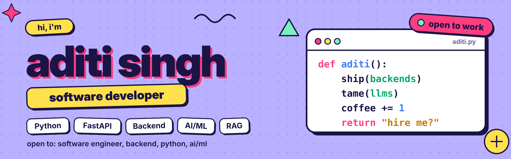

  

  

  
  
  

---

## 👋 About Me

I'm a **Software Developer** and Computer Science graduate who builds backend services and AI-powered applications. I like turning ideas into working software, from REST APIs and databases to retrieval pipelines and LLM workflows.

- 🔭 **Currently building:** Cognivault, a RAG-based document Q&A app
- 🌱 **Currently learning:** LangGraph, MLOps and deploying LLM apps
- 🤝 **Open to:** Software Engineer, Python/Backend Developer, AI/ML Engineer and Graduate Engineer Trainee roles
- 😄 **Fun fact:** my favourite bug fix is still `blame(cache)`

---

## 🛠️ Tech Stack

  

---

## 🚀 Featured Projects

| Project | What it does | Built with |
| :-- | :-- | :-- |
| 📚 **[Cognivault](https://github.com/AditiSingh-08/Cognivault)** | Upload documents, ask questions in plain language and get answers from your own files | `Python` `FastAPI` `LangChain` `LangGraph` `Streamlit` `RAG` |
| 🛡️ **AssetGuard AI** *(in development)* | Predictive maintenance: failure prediction, document search and supervisor-approved repair jobs | `Python` `Machine Learning` `Agent workflow` |
| 🐴 [**Trojan Check**](https://github.com/AditiSingh-08/trojan-check) | Static triage for suspicious files: upload an .exe, .pdf or Word file and get an explained 0-100 risk score, file hashes and a PDF report | `Python` `FastAPI` `React` `YARA` `JWT` |
---

## 🎓 Training & Experience

### LTIMindtree: Graduate Engineer Trainee (GET), AI Services

Completed a 3-month structured technical training program covering backend development, data processing, AI/ML, and modern AI application development.

- **Backend Development:** Built REST APIs using FastAPI and SQLAlchemy, working with CRUD operations, filtering, sorting, database relationships, API testing, and debugging.
- **Programming & Data:** Python, Java, SQL, NumPy, and Pandas.
- **AI & Machine Learning:** Machine Learning and Deep Learning fundamentals, Large Language Models (LLMs), and Retrieval-Augmented Generation (RAG).
- **Generative AI Frameworks:** LangChain and LangGraph for developing LLM-powered applications and workflows.
- **Engineering Practices:** MLOps, DevOps, and cloud computing fundamentals.
- **Assessments:** Completed coding assignments, weekly knowledge assessments, milestone evaluations, and mock interviews.

## 🌐 Let's Connect

I'm looking for software and backend roles where I can ship real features and learn from experienced engineers. If you're hiring, or just want to talk code, reach out on [LinkedIn](https://www.linkedin.com/in/aditi-singh-13686b24a/).

<i>Thanks for stopping by. May your builds be green and your caches be blameless.</i>

