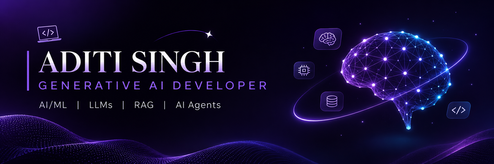

  

# 👋 Hi, I'm Aditi Singh

### 💜 Generative AI Developer | LLMs, RAG & AI Agents

Computer Science graduate who builds intelligent applications with LLMs. I enjoy turning ideas into working AI products, from retrieval pipelines to agent workflows.

🔭 Currently building: Cognivault a RAG-based document Q&A app
🌱 Currently learning: LangGraph, MLOps and deploying LLM apps
🤝 Open to: AI/ML and Generative AI roles (entry level)

### 🛠️ Tech Stack

`Python` `LLMs` `RAG` `LangChain` `LangGraph` `FastAPI` `Machine Learning` `Deep Learning` `CNN` `SQL` `MLOps` `DevOps`

## 🎓 Training & Experience

### LTIMindtree — Graduate Engineer Trainee (GET), AI Services

Completed a 3-month structured technical training program covering backend development, data processing, AI/ML, and modern AI application development.

- **Backend Development:** Built REST APIs using FastAPI and SQLAlchemy, working with CRUD operations, filtering, sorting, database relationships, API testing, and debugging.
- **Programming & Data:** Python, Java, SQL, NumPy, and Pandas.
- **AI & Machine Learning:** Machine Learning and Deep Learning fundamentals, Large Language Models (LLMs), and Retrieval-Augmented Generation (RAG).
- **Generative AI Frameworks:** LangChain and LangGraph for developing LLM-powered applications and workflows.
- **Engineering Practices:** MLOps, DevOps, and cloud computing fundamentals.
- **Assessments:** Completed coding assignments, weekly knowledge assessments, milestone evaluations, and mock interviews.
  
### 🌐 Connect With Me

[LinkedIn](https://www.linkedin.com/in/aditi-singh-13686b24a) • [GitHub](https://github.com/AditiSingh-08)

